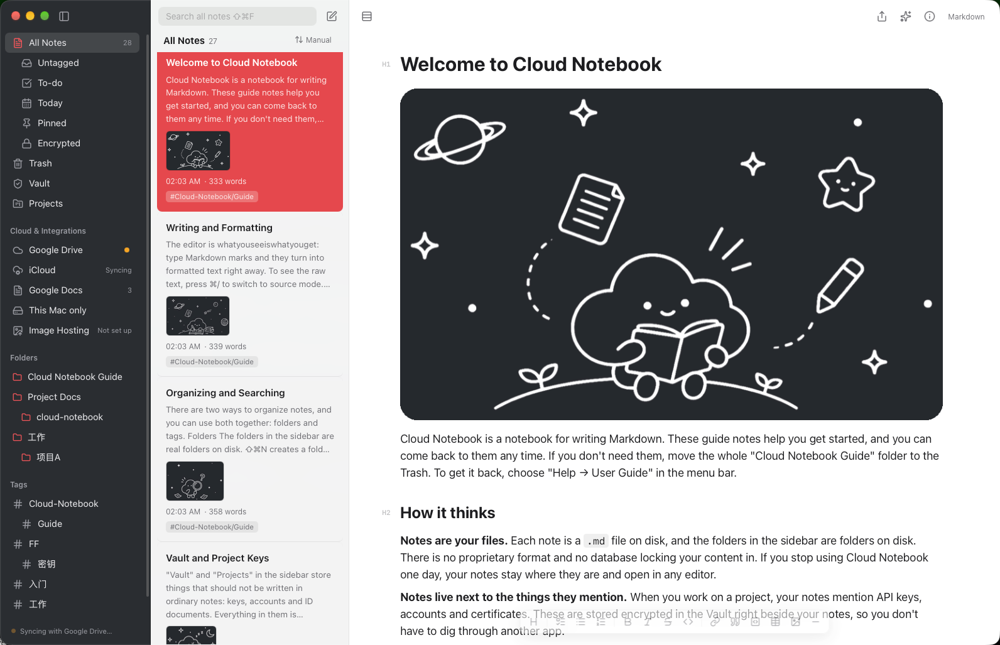

# Cloud Notebook

A Markdown notebook for macOS that keeps your notes as plain files, with an encrypted vault for project keys and documents built in.

[Website](https://xingguiyu.github.io/cloud-notebook/) · [简体中文](README.zh-CN.md)



> The interface is available in English and Simplified Chinese. It follows the system language and can be switched in Settings → General.

## Why

Most note apps treat secrets as an afterthought. When you work on several projects you end up with API keys in one app, `.env` files in another, and the notes that explain them in a third. Cloud Notebook keeps the notes and the things they refer to in one place, on your own disk.

## Features

**Notes**

- Notes are ordinary `.md` files in a folder you choose. Nothing is locked in a database.
- Live Markdown editor (Milkdown) with a source mode (CodeMirror), outline, tables, task lists, code blocks and `==highlight==`.
- Folders, tags, pinning, multi-select with batch actions, trash.
- Full-text search across all notes (SQLite FTS5, works for Chinese), plus find and replace inside a note.
- Seven themes, light and dark, editor zoom, resizable panes.
- Export to PDF, Word, HTML, or a zip with images.
- Paste from Bear keeps headings, lists and images.

**Vault**

- Templates for API keys, LLM keys, accounts, certificates, bank cards, IDs and passports.
- LLM keys: the provider is detected from the key prefix, and base URL and console link are filled in.
- Copy a project's keys as `.env` lines.
- Reminders before a key or document expires.
- Photos of IDs and passports are read on device (Apple Vision OCR) to fill in the fields.
- Everything in the vault is encrypted with AES-256-GCM. The key is derived from your password with Argon2id and never leaves the device. Unlock with Touch ID.

**Project documents for AI coding**

- An MCP server is built into the app. Claude Code, Cursor and other agents can save plans, designs and specs into the matching project folder instead of leaving loose files in the repository.
- Every document carries a status: current, draft, superseded or archived. Superseded and archived ones are folded away, so the list shows what is valid now.
- Scan a repository for scattered Markdown files and import them in one go. Originals are copied, never moved.
- Version history for every note: earlier content is kept on this Mac, with a line-by-line comparison and one-click restore.
- The agent can only reach project document folders. Other notes and the vault are out of its reach.

**Sync and AI, both optional**

- Sync through iCloud Drive, or through your own Google Drive (`drive.file` scope only; experimental). Without sync, everything stays on this Mac.
- Updates itself from GitHub releases after verifying the signature; the check can be turned off.
- AI assistant that uses your own API key: OpenAI, Anthropic, Gemini, DeepSeek, Qwen, OpenRouter and other OpenAI-compatible endpoints.
- Upload images to your own S3-compatible storage.

## Install

Download the latest `.dmg` from [Releases](https://github.com/xingguiyu/cloud-notebook/releases). Builds are signed and notarized. Requires macOS 11 or later.

## Build from source

Requirements: Rust 1.95+, Node 22+, pnpm 10+, Xcode command line tools.

```sh
pnpm install
pnpm tauri dev      # run in development
pnpm tauri build    # unsigned build
```

Checks:

```sh
pnpm test                       # front-end unit tests
pnpm build                      # type check and bundle the front end
cd src-tauri && cargo test      # Rust tests
```

`pnpm release` builds, signs with the Developer ID certificate in your keychain, and notarizes. See the comments at the top of `scripts/release.sh`.

## Releases

Pushing a tag builds the app on GitHub Actions and publishes it as a release, for Apple silicon and Intel:

```sh
# set the same version in src-tauri/Cargo.toml and src-tauri/tauri.conf.json first
git tag v0.8.0 && git push origin v0.8.0
```

The app updates itself: it reads `latest.json` from the newest GitHub release, downloads the update package, verifies its signature against the public key in `src-tauri/tauri.conf.json`, installs it and restarts. The notes shown in the update dialog are the changelog section of that version, so write `CHANGELOG.md` and `CHANGELOG.zh-CN.md` before releasing.

Releases can also be cut from a Mac that has the signing certificate:

```sh
pnpm release           # build, sign, notarize; files land in release/v<version>/
pnpm release:publish   # create the GitHub release from them
```

A mirror for mainland China (website, installers and the update manifest) is kept at notebook.qxsclass.com; `pnpm site:deploy` syncs it after a release. The app asks GitHub first and falls back to the mirror.

Either way the update packages are signed with a private key that is not in the repository. Locally it is read from `~/.tauri/cloud-notebook.key`; in CI from the `TAURI_SIGNING_PRIVATE_KEY` secret. Anyone who forks the project must generate their own pair (`pnpm tauri signer generate`) and replace the public key and the update address in `tauri.conf.json`. Losing the private key means installed copies can no longer be updated.

The workflow (`.github/workflows/release.yml`) runs the tests, checks that the tag matches the app version, and uploads the `.dmg` files. To have the builds signed and notarized, add these repository secrets. Without them a tag only runs the tests; an unsigned build can be made by starting the workflow by hand.

| Secret | Value |
|---|---|
| `APPLE_CERTIFICATE` | Developer ID Application certificate exported as `.p12`, base64 encoded (`base64 -i cert.p12`) |
| `APPLE_CERTIFICATE_PASSWORD` | Password of that `.p12` |
| `APPLE_SIGNING_IDENTITY` | Certificate name, e.g. `Developer ID Application: Name (TEAMID)` |
| `APPLE_ID` | Apple ID used for notarization |
| `APPLE_PASSWORD` | App-specific password for that Apple ID |
| `APPLE_TEAM_ID` | Team ID |
| `TAURI_SIGNING_PRIVATE_KEY` | Contents of the update-signing private key |
| `TAURI_SIGNING_PRIVATE_KEY_PASSWORD` | Its password, if it has one |

Every push and pull request also runs the tests (`.github/workflows/ci.yml`).

## Project layout

| Path | Contents |
|---|---|
| `src/` | Vue 3 front end |
| `src/editor/` | Editor plugins: paste handling, find and replace, highlight |
| `src/safe/` | Vault: item templates, OCR parsing, encrypted files |
| `src/ai/` | AI providers and client |
| `src/i18n.ts`, `src/locales/` | Interface translations |
| `src-tauri/src/` | Rust back end: note library, search index, Google Drive sync, key derivation, export |
| `src-tauri/src/docs.rs`, `mcp.rs` | Project documents, version history, MCP server |
| `skills/` | Skill for AI coding tools |
| `docs/` | Setup guides |
| `site/` | Website and privacy policy |

## Connect an AI coding tool

Open **Settings → 项目文档** and copy the command shown there. For Claude Code it looks like this:

```sh
claude mcp add --scope user cloud-notebook -- "/Applications/Cloud Notebook.app/Contents/MacOS/app" mcp
```

The first time an agent saves a document from a repository, a folder named after the repository is created under `项目文档/` and bound to it. You can also bind any existing folder: right-click it in the sidebar and choose **绑定本地项目目录**.

An optional skill that tells the agent when to use these tools is in [`skills/cloud-notebook-docs`](skills/cloud-notebook-docs/SKILL.md). Copy that folder into `~/.claude/skills/`.

Status is stored as front matter in the file itself, so documents stay readable anywhere:

```markdown
---
status: superseded
type: design
source: docs/payment.md
superseded_by: 项目文档/shop/支付方案 v2.md
---
```

## Translations

Interface text is looked up by its Chinese source string: `t('移到回收站')` shows the Chinese as written and, for other languages, the entry from a dictionary in `src/locales/<language>/`. Adding a language means adding one more dictionary:

1. Copy `src/locales/en/` to `src/locales/<code>/` and translate the values. Keys stay in Chinese.
2. Register it in `src/i18n.ts` (`Lang`, `LANG_OPTIONS`, `DICTS`).
3. Translate the native menu in `src-tauri/src/i18n.rs` and, optionally, the guide notes in `src-tauri/guide/`.
4. If you changed any guide note or image, run `python3 scripts/guide-hashes.py`.
5. Run `python3 scripts/i18n-check.py`. It reports strings without a translation and placeholders that do not match.

When one Chinese word needs two different translations, the key carries a context after `||`, for example `置顶||分类` ("Pinned" as a category) next to `置顶` ("Pin" as an action).

Error messages that come from the Rust side are still Chinese only.

## Google Drive sync

Sync uses an OAuth client that you create in your own Google Cloud project, so your data never passes through a server run by this project. Setup takes about ten minutes: [docs/google-drive-setup.md](docs/google-drive-setup.md) (Chinese).

## Contributing

See [CONTRIBUTING.md](CONTRIBUTING.md). Changes are listed in [CHANGELOG.md](CHANGELOG.md).

## Privacy

The app has no analytics and no account system. See the [privacy policy](https://xingguiyu.github.io/cloud-notebook/privacy.html).

## License

Copyright © 2026 Samuel Xing (XING GUIYU). Licensed under [AGPL-3.0](LICENSE). Official signed builds are published by Sichuan Yuejian Chuhua Culture Media Co., Ltd. (四川月见初花文化传媒有限公司).

The name "Cloud Notebook" and the app icon are not covered by the license; forks should use a different name and icon.

Security issues: see [SECURITY.md](SECURITY.md).
