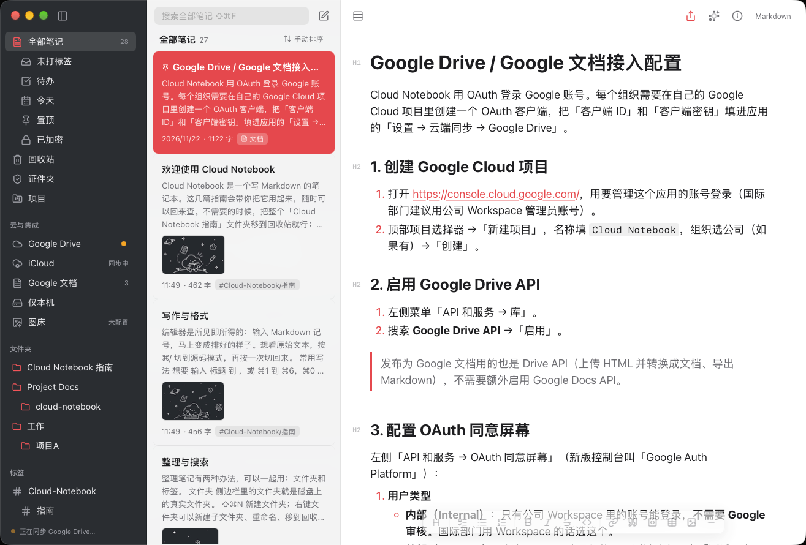

# Cloud Notebook

macOS 上的 Markdown 笔记本。笔记是你磁盘上的普通文件，内置加密的「项目 / 证件夹」，用来保存项目密钥和证件。

[官网](https://xingguiyu.github.io/cloud-notebook/) · [English](README.md)



## 为什么做这个

同时做几个项目时，API Key 在一个应用里，`.env` 文件在另一个地方，解释它们的笔记又在第三个地方。Cloud Notebook 把笔记和笔记里提到的密钥、账号、证件放在一起，都存在你自己的磁盘上。

## 功能

**笔记**

- 笔记是普通的 `.md` 文件，放在你选的文件夹里，不锁在数据库中。
- 所见即所得的 Markdown 编辑器（Milkdown），可切换源码模式（CodeMirror）；支持大纲、表格、任务列表、代码块、`==高亮==`。
- 文件夹、标签、置顶、多选批量操作、回收站。
- 全部笔记的全文搜索（SQLite FTS5，支持中文），笔记内查找替换。
- 七套主题，浅色与深色，编辑区缩放，栏宽可拖动。
- 导出 PDF、Word、HTML，或带图片的 zip。
- 从 Bear 粘贴时保留标题、列表和图片。

**项目 / 证件夹**

- 内置模板：接口 API Key、大模型 Key、账号、证书、银行卡、身份证、护照等。
- 大模型 Key：根据 Key 前缀识别服务商，自动填好接口地址和控制台链接。
- 一键把项目里的密钥复制成 `.env` 格式。
- 密钥和证件到期前提醒。
- 身份证、护照照片在本机识别（Apple Vision OCR），自动填入字段。
- 全部内容用 AES-256-GCM 加密，密钥由你的密码经 Argon2id 派生，不离开本机；支持 Touch ID 解锁。

**AI 编程的项目文档**

- 应用内置 MCP 服务。Claude Code、Cursor 等工具可以把计划、方案、设计文档直接存进对应项目的文件夹，不再散落在仓库里。
- 每份文档带状态：当前有效、草稿、已被取代、已归档。被取代和归档的默认收起，列表里看到的就是现在有效的。
- 扫描仓库里已经散落的 Markdown 文件，一次导入。原文件只复制，不移动。
- 每篇笔记都有版本历史：修改前的内容保存在本机，可以逐行对比、一键恢复。
- AI 只能读写项目文档文件夹，读不到其他笔记，也碰不到证件夹。

**同步与 AI（都可以不开）**

- 通过 iCloud Drive 同步，或通过你自己的 Google Drive 同步（只申请 `drive.file` 权限，实验性功能）。不开同步时，所有内容只在本机。
- 从 GitHub Release 自动更新，安装前校验签名；自动检查可以关闭。
- AI 助手使用你自己的 API Key：OpenAI、Anthropic、Gemini、DeepSeek、通义千问、OpenRouter，以及其他 OpenAI 兼容接口。
- 图片可以上传到你自己的 S3 兼容存储。

## 安装

到 [Releases](https://github.com/xingguiyu/cloud-notebook/releases) 下载最新的 `.dmg`。安装包已签名并通过 Apple 公证，需要 macOS 11 或更高版本。

## 从源码构建

环境：Rust 1.95+、Node 22+、pnpm 10+、Xcode 命令行工具。

```sh
pnpm install
pnpm tauri dev      # 开发运行
pnpm tauri build    # 不签名的构建
```

检查：

```sh
pnpm test                       # 前端单元测试
pnpm build                      # 类型检查并打包前端
cd src-tauri && cargo test      # Rust 测试
```

`pnpm release` 会构建、用钥匙串里的 Developer ID 证书签名并公证，说明见 `scripts/release.sh` 开头的注释。

## 发版

推送一个 tag，GitHub Actions 会自动构建并发布到 Releases，包含 Apple 芯片和 Intel 两个版本：

```sh
# 先把 src-tauri/Cargo.toml 和 src-tauri/tauri.conf.json 里的版本号改成一致的新版本
git tag v0.8.0 && git push origin v0.8.0
```

应用会自己更新：它读取最新一个 GitHub Release 里的 `latest.json`，下载更新包，用 `src-tauri/tauri.conf.json` 里的公钥校验签名，安装并重启。更新弹窗里显示的说明取自更新日志里这个版本的一节，所以发版前要先写好 `CHANGELOG.md` 和 `CHANGELOG.zh-CN.md`。

也可以在装有签名证书的 Mac 上本地发版：

```sh
pnpm release           # 构建、签名、公证，产物在 release/v<版本>/
pnpm release:publish   # 用这些文件创建 GitHub Release
```

两种方式都要用一把不在仓库里的私钥给更新包签名。本地从 `~/.tauri/cloud-notebook.key` 读取，CI 里从 `TAURI_SIGNING_PRIVATE_KEY` 这个 Secret 读取。分叉这个项目的人需要自己生成一对密钥（`pnpm tauri signer generate`），并替换 `tauri.conf.json` 里的公钥和更新地址。私钥丢了，已经装出去的版本就再也无法自动更新。

流水线（`.github/workflows/release.yml`）会跑测试、检查 tag 和应用版本号一致，然后上传 `.dmg`。想让安装包带签名并通过 Apple 公证，在仓库的 Secrets 里加上下面几项。没配的时候推 tag 只跑测试、不出包；需要未签名的包可以在 Actions 页面手动运行这条流水线。

| Secret | 内容 |
|---|---|
| `APPLE_CERTIFICATE` | Developer ID Application 证书导出的 `.p12`，转成 base64（`base64 -i cert.p12`） |
| `APPLE_CERTIFICATE_PASSWORD` | 这个 `.p12` 的密码 |
| `APPLE_SIGNING_IDENTITY` | 证书名称，例如 `Developer ID Application: 名称 (TEAMID)` |
| `APPLE_ID` | 用于公证的 Apple ID |
| `APPLE_PASSWORD` | 这个 Apple ID 的 App 专用密码 |
| `APPLE_TEAM_ID` | Team ID |
| `TAURI_SIGNING_PRIVATE_KEY` | 更新签名私钥的内容 |
| `TAURI_SIGNING_PRIVATE_KEY_PASSWORD` | 私钥的密码（有的话） |

每次推送和 PR 也会自动跑测试（`.github/workflows/ci.yml`）。

## 目录结构

| 路径 | 内容 |
|---|---|
| `src/` | Vue 3 前端 |
| `src/editor/` | 编辑器插件：粘贴处理、查找替换、高亮 |
| `src/safe/` | 证件夹：条目模板、OCR 解析、加密文件 |
| `src/ai/` | AI 服务商与调用 |
| `src/i18n.ts`、`src/locales/` | 界面翻译 |
| `src-tauri/src/` | Rust 后端：笔记库、搜索索引、Google Drive 同步、密钥派生、导出 |
| `src-tauri/src/docs.rs`、`mcp.rs` | 项目文档、版本历史、MCP 服务 |
| `skills/` | 给 AI 编程工具用的 Skill |
| `docs/` | 配置指南 |
| `site/` | 官网和隐私政策 |

## 接入 AI 编程工具

打开**设置 → 项目文档**，复制里面的命令。Claude Code 的命令是：

```sh
claude mcp add --scope user cloud-notebook -- "/Applications/Cloud Notebook.app/Contents/MacOS/app" mcp
```

AI 第一次在某个仓库里保存文档时，会在「项目文档」下新建一个和仓库同名的文件夹并绑定。也可以绑定已有的文件夹：在侧边栏右键它，选**绑定本地项目目录**。

仓库里的 [`skills/cloud-notebook-docs`](skills/cloud-notebook-docs/SKILL.md) 是一个可选的 Skill，告诉 AI 什么时候该用这些工具。把这个文件夹复制到 `~/.claude/skills/` 即可。

状态以 front matter 的形式写在文件头部，文档在任何编辑器里都能读：

```markdown
---
status: superseded
type: design
source: docs/payment.md
superseded_by: 项目文档/shop/支付方案 v2.md
---
```

## 多语言

界面文字用中文原文当词条的键：`t('移到回收站')` 在中文界面直接显示原文，其他语言去 `src/locales/<语言>/` 的词表里查。加一种语言就是加一份词表：

1. 把 `src/locales/en/` 复制成 `src/locales/<语言代码>/`，翻译里面的值，键保持中文不变。
2. 在 `src/i18n.ts` 里登记（`Lang`、`LANG_OPTIONS`、`DICTS`）。
3. 翻译 `src-tauri/src/i18n.rs` 里的原生菜单；使用指南（`src-tauri/guide/`）可选。
4. 改过指南的文字或图片的话，运行 `python3 scripts/guide-hashes.py`。
5. 运行 `python3 scripts/i18n-check.py`，它会报出缺译文的词条和对不上的变量。

同一个中文词在不同位置要译成不同的词时，键后面用 `||` 带上说明，比如 `置顶||分类`（分类名）和 `置顶`（动作）。

目前有简体中文和英文。Rust 端返回的错误信息暂时只有中文。

## Google Drive 同步

同步使用你在自己的 Google Cloud 项目里创建的 OAuth 客户端，数据不经过本项目的任何服务器。配置约十分钟：[docs/google-drive-setup.md](docs/google-drive-setup.md)。

## 参与贡献

见 [CONTRIBUTING.md](CONTRIBUTING.md)。各版本的变化记在 [CHANGELOG.md](CHANGELOG.md)。

## 隐私

应用没有统计代码，也没有账号系统。见[隐私政策](https://xingguiyu.github.io/cloud-notebook/privacy.html)。

## 许可证

版权所有 © 2026 Samuel Xing (XING GUIYU)，以 [AGPL-3.0](LICENSE) 许可发布。官方签名的安装包由四川月见初花文化传媒有限公司发布。

"Cloud Notebook" 名称和应用图标不在许可范围内，分支版本请使用其他名称和图标。

安全问题请见 [SECURITY.md](SECURITY.md)。
